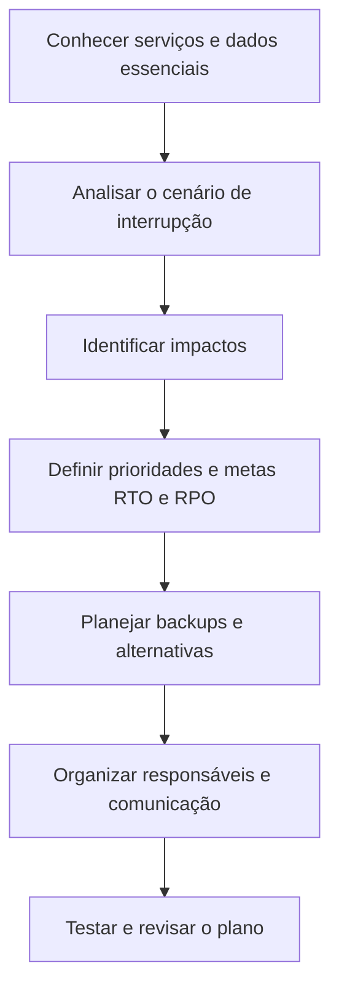

# Recuperação de desastres: proteção de dados e serviços

## Visão geral

O que uma empresa pode fazer quando seus sistemas ficam indisponíveis ou informações são perdidas? 

> Neste laboratório da **Cisco Networking Academy (NetAcad)**, são analisados cenários fictícios que afetam uma empresa de aulas particulares.

A atividade propõe medidas para recuperar dados e serviços após um desastre natural, um possível ataque de negação de serviço e uma perda de dados. O estudo destaca backups, alternativas de acesso e planejamento da recuperação.

---

## Objetivos

- Identificar impactos de interrupções em serviços e dados.
- Reconhecer a importância de um plano de recuperação de desastres.
- Entender os conceitos de RTO e RPO.
- Recomendar medidas para três cenários de interrupção.
- Relacionar backups, comunicação e responsabilidades à recuperação dos serviços.

---

## Cenário do laboratório

A empresa fictícia oferece aulas particulares presenciais e on-line para alunos de diferentes localidades. Um data center em nuvem disponibiliza materiais didáticos, registros de alunos, inscrições e videoconferências. Também apoia rotinas internas, como backups dos servidores da empresa.

Como vários serviços dependem desse ambiente, uma interrupção pode afetar o acesso dos alunos, o trabalho dos instrutores e as atividades internas. O laboratório propõe analisar esses impactos e recomendar medidas de recuperação.

---

## O que é um plano de recuperação de desastres?

É um conjunto de orientações para ajudar uma organização a recuperar sistemas, dados e serviços de TI após uma interrupção. O planejamento considera pessoas, equipamentos, locais e serviços essenciais.

---

| Elemento | Para que serve? |
|---|---|
| Responsáveis | Definir quem coordena a recuperação e executa cada atividade. |
| Serviços prioritários | Identificar o que precisa voltar primeiro. |
| Backups | Disponibilizar cópias para recuperar informações. |
| Ambiente alternativo | Oferecer outra opção para restaurar serviços essenciais. |
| Comunicação | Orientar funcionários, instrutores e clientes durante a interrupção. |
| Testes e revisão | Verificar o plano e mantê-lo atualizado. |

---

## Metas de recuperação: RTO e RPO

| Conceito | Pergunta que ajuda a responder | Exemplo simples |
|---|---|---|
| **RTO**: objetivo de tempo de recuperação | Em quanto tempo o serviço precisa voltar? | Se a meta for quatro horas, a equipe planeja restaurar o serviço dentro desse período. |
| **RPO**: objetivo de ponto de recuperação | Qual é a perda de dados aceitável, medida em tempo? | Com RPO de uma hora, busca-se poder recuperar os dados até um ponto de no máximo uma hora antes da interrupção. |

---

## Etapas da análise

1. Entender os serviços e as informações importantes para a empresa.
2. Avaliar como cada cenário afeta alunos, instrutores e funcionários.
3. Identificar alternativas para a continuidade das atividades essenciais.
4. Recomendar medidas para recuperação de dados e serviços.
5. Definir responsáveis, comunicação e testes do plano.

---

---

## Cenário 1: desastre natural

Um furacão ou tufão causa danos à infraestrutura de rede próxima ao data center. Os servidores deixam de ser acessíveis remotamente e o exercício considera pelo menos uma semana sem acesso ao local.

| Possível impacto | Medida recomendada |
|---|---|
| Alunos não conseguem acessar materiais e contas hospedados no ambiente afetado. | Manter cópias atualizadas dos dados essenciais em outro local. |
| Instrutores podem ficar sem acesso à videoconferência e aos registros dos alunos. | Identificar e testar serviços alternativos de comunicação. |
| O cadastro e as informações internas podem ficar indisponíveis. | Planejar um ambiente secundário para recuperar serviços prioritários e acesso autorizado dos funcionários. |
| A interrupção pode durar vários dias. | Manter o plano acessível aos responsáveis, inclusive durante a indisponibilidade do ambiente principal. |

**Resultado esperado:** restabelecer os serviços essenciais em um ambiente alternativo conforme a prioridade e as metas definidas no plano. Algumas atividades presenciais ou aulas por canais alternativos podem continuar, dependendo das condições disponíveis.

---

## Cenário 2: possível ataque de negação de serviço

Alguns usuários relatam dificuldade para entrar em suas contas e acessar os materiais. A investigação do cenário identifica muitas solicitações ao servidor web em um horário normalmente pouco movimentado, indicando um possível ataque de negação de serviço.

| Possível impacto | Medida recomendada |
|---|---|
| O site ou os serviços atingidos podem ficar indisponíveis. | Acionar os responsáveis e investigar a origem e o impacto das solicitações. |
| Alunos e instrutores podem perder acesso aos serviços afetados. | Usar canais alternativos de comunicação previamente identificados e testados. |
| Serviços essenciais podem precisar de recuperação. | Manter cópias dos dados e servidores em outro local, com um plano para sua implantação. |

**Resultado esperado:** organizar a resposta e recuperar o acesso aos serviços. A recuperação em outro ambiente precisa considerar também a mitigação do ataque, pois a simples troca de local não garante que o tráfego malicioso deixará de afetar o serviço.

---

## Cenário 3: perda de dados

Alguns usuários não conseguem entrar ou redefinir credenciais; outros percebem a ausência do progresso recente nas aulas. No cenário, a investigação aponta **erro humano** como causa da perda de dados.

| Possível impacto | Medida recomendada |
|---|---|
| Dados de contas ou de progresso podem precisar de recuperação. | Manter backups dos dados essenciais em diferentes períodos. |
| Uma cópia recente pode conter dados já danificados. | Identificar uma versão íntegra antes da restauração. |
| A restauração de uma cópia antiga pode deixar alterações recentes de fora. | Avaliar a perda aceitável, o RPO e a possibilidade de recuperar apenas os dados afetados. |
| A recuperação pode levar tempo. | Planejar recursos redundantes e testar a restauração de dados. |

**Resultado esperado:** recuperar informações a partir de uma cópia adequada, reduzindo a perda de dados e a interrupção conforme as metas estabelecidas.

---

### Exemplo de versões de backup

Se um problema nos dados ocorreu há dois dias, uma cópia de três dias atrás pode ser uma alternativa de recuperação. Porém, restaurar toda essa cópia pode fazer com que alterações posteriores sejam perdidas. Quando possível e apropriado, recuperar apenas os dados afetados pode reduzir essa perda.

---

## Comparação dos cenários

| Cenário | Principal preocupação | Medidas em destaque |
|---|---|---|
| Desastre natural | Perda de acesso ao data center e à rede. | Ambiente alternativo, backups e comunicação. |
| Possível DDoS | Sobrecarga e indisponibilidade de serviços. | Investigação, mitigação, comunicação e recuperação. |
| Perda de dados | Contas ou informações de progresso afetadas. | Versões de backup, restauração e definição de RPO. |

---

## Conhecimentos trabalhados

- Identificar como a indisponibilidade de TI pode afetar clientes e equipes.
- Diferenciar o tempo para recuperar um serviço da perda de dados aceitável.
- Reconhecer a importância de cópias em diferentes locais e momentos.
- Planejar alternativas para os serviços e a comunicação.
- Entender que um plano precisa de responsáveis, treinamento, testes e revisão.
- Relacionar a recuperação de desastres ao trabalho conjunto de Suporte de TI e Cibersegurança.

---

## Entendendo os termos técnicos

| Termo | O que significa? |
|---|---|
| Recuperação de desastres | Preparação para recuperar dados e serviços de TI após uma interrupção grave. |
| Data center | Ambiente que reúne equipamentos e sistemas usados para armazenar dados e oferecer serviços. |
| Nuvem | Serviços de tecnologia acessados pela rede e mantidos em infraestrutura de um provedor. |
| Backup | Cópia de dados usada para ajudar na recuperação. |
| RTO | Tempo definido como meta para recuperar um serviço. |
| RPO | Limite definido para a perda de dados aceitável, medido em tempo. |
| DDoS | Ataque que usa várias origens para sobrecarregar um serviço e tentar torná-lo indisponível. |
| Redundância | Uso de recursos alternativos para ajudar a manter ou recuperar um serviço em caso de falha. |

---

## Onde esse conhecimento pode ser aplicado?

**Cenário fictício: plataforma de cursos**

**Situação:** uma plataforma de cursos depende de seus sistemas para disponibilizar aulas e guardar o progresso dos estudantes. Uma falha pode interromper o acesso.

**Aplicação:** a equipe pode definir a prioridade dos serviços, estabelecer metas de RTO e RPO, manter backups em outro local e testar a restauração. Um canal alternativo pode informar alunos e instrutores durante a interrupção.

**Benefício esperado:** recuperar os serviços de forma organizada e reduzir o impacto da interrupção, aplicando os conceitos estudados no laboratório.
